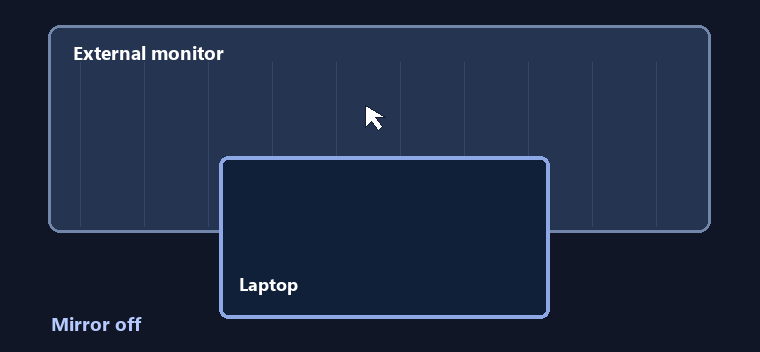

My laptop sits in front of my monitor. Windows lets me put the two displays edge to edge, but a chunk of the monitor is still physically behind the lid. Screen Seam puts that chunk on the laptop, right where it belongs. You can click it, scroll it, or drag a window through it.

**[Download the Windows installer](https://github.com/Fleishigs/screen-seam/releases/latest)**



## Line it up

1. Set Windows to **Extend**. In Display settings, put the external monitor directly above the laptop, with their edges touching.
2. Open **Screen Seam** and choose **Drag calibration lines**. Line up the guides with the lit edges of the screens. The arrow keys move a guide one pixel.
3. Save, then move your pointer down through the overlap. Click an exposed part of the mirror to bring it forward. Click the visible part of a laptop app to use that app again.

The laptop keeps its full desktop. **Match laptop** sizes the mirrored content for the laptop's Windows scaling. **Fill calibrated area** follows the edges you marked.

| Shortcut | Action |
| --- | --- |
| Ctrl + Alt + F11 | Pause or resume the mirror |
| Ctrl + Alt + F10 | Fit the active window to the area under the pointer |
| Double-click the tray icon | Open settings |

## Build on Windows

```powershell
.\build.ps1
.\ScreenSeam.exe
```

The build uses the 64-bit .NET Framework C# compiler included with Windows. To package the MSI, run `python package.py` after building. Python 3 and the Windows cabinet maker are required.

The integration tests open temporary windows on two displays. The reference setup is a 1920 × 1080 upper monitor at 100% and a 1920 × 1080 laptop at 125%.

```powershell
Start-Process .\ScreenSeam.exe -ArgumentList '--test results.txt' -Wait
Get-Content results.txt
```
